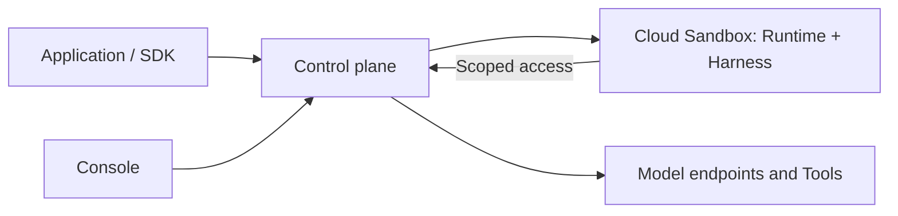

# Hexagon

**A self-hostable Agent control plane for applications.** Create stateful Sessions through Python, TypeScript or REST, run Agent tasks in cloud Sandboxes, observe durable events, and retrieve results and artifacts. Console manages connections and execution; the selected Harness runs the Agent inside the Sandbox.

[中文](README.zh-CN.md) · [Documentation](docs/product/en/index.md) · [First Session](docs/product/en/start/first-session.md) · [Coding Agent guide](docs/product/en/agents.md)

**Developer preview preparation, not a stable public release.** This checkout contains scoped real-cloud evidence; it does not establish universal Sandbox × Harness compatibility. Public distribution approval remains pending in [release-policy.json](release-policy.json). Project code is [Apache-2.0](LICENSE), with applicable [third-party notices](THIRD_PARTY_NOTICES.md).

## What you can build

Give an Agent a Web project, ask it to implement a filter, inspect the actual test output and private preview, download the changed files, then continue the conversation in the same workspace. Hexagon manages the execution lifecycle around that task:

| Your application does | Hexagon provides |
| --- | --- |
| Creates work context and submits tasks | Pinned Session configuration and Run state |
| Displays progress and reconnects | Persisted events and cursor-based replay |
| Connects external Tools | Scoped account access, authorization and write approval |
| Delivers results and ends work | Exported artifacts, private previews where supported, resource cleanup and reconciliation |

Your application retains business identity, user permissions and its own task records. See [use cases and boundaries](docs/product/en/start/use-cases.md).



## Start from a source checkout

Prepare Node.js 22.19+, an existing dedicated PostgreSQL database, and Python 3.10+ for Python clients. Temporary development credential ingress uses cloudflared; provider-specific dependencies are described in the [installation guide](docs/product/en/start/install.md).

```sh
npm ci
# Substitute an existing dedicated database and your local authentication settings.
export DATABASE_URL='postgres://YOUR_USER@127.0.0.1:5432/hexagon'
npm run local -- doctor
npm run local -- start
npm run local -- status
```

Open [local Console](http://127.0.0.1:8787/console/). Local Console and `Hexagon.local()` use workspace discovery; hosted clients use explicit credentials. The commands do not create PostgreSQL or its database. Read [installation](docs/product/en/start/install.md) for data directories, ingress and SDK installation before running a cloud task.

Then follow [Your first Session](docs/product/en/start/first-session.md): connect and verify one Sandbox and model, choose a compatible Harness, submit work, check its result and artifact, close the Session, and verify retained artifacts. Saving an Agent is optional. Tools and OAuth are not prerequisites for this first task. Cloud resources and model calls use your accounts and may incur charges.

The tutorial's complete [Python](examples/documentation/first-session.py) and [TypeScript](examples/documentation/first-session.ts) programs retain private journals and check cleanup. Run them with the tutorial prerequisites and connection IDs, not as standalone snippets without setup. Console's API Playground can also generate calls for your selected connections.

## Continue with your product

| Goal | Guide |
| --- | --- |
| Add Agent execution to a backend | [Backend integration](docs/product/en/build/backend-integration.md) |
| Supply a project and inspect the result | [Project context](docs/product/en/build/project-context.md) and [artifacts](docs/product/en/build/artifacts.md) |
| Handle authorization, approvals and failures | [Tool authorization](docs/product/en/build/tool-authorization.md), [approvals](docs/product/en/build/approvals.md), [recovery](docs/product/en/build/recovery.md) |
| Operate your own control plane | [Self-hosting](docs/product/en/operate/self-host.md), [networking](docs/product/en/operate/networking.md), [backup/restore](docs/product/en/operate/backup-restore.md) |
| Find all existing documentation | [Documentation directory](docs/product/en/directory.md) |

## Execution and security boundaries

Local and hosted refer to the control plane. Real execution uses cloud Sandboxes. Runtime supervises Harness processes; provider and original upstream credentials remain in the control plane. Guests receive scoped access whose permissions still matter. Keep the database and its matching encryption key together. Temporary credential ingress must not expose the management API; hosted deployments need appropriate stable HTTPS ingress. See [security](SECURITY.md).

Disconnecting an event stream does not cancel a Run. Explicitly close unused Sessions and confirm cleanup. Paused does not universally mean free, and some expiry/cleanup mechanisms require the control plane to stay running. Unknown remote outcomes require [reconciliation](docs/product/en/operate/reconciliation.md), not blind retries.

Image support, model protocols, Tool bridges and restoration vary by combination. Check [integration selection](docs/product/en/integrations/choose.md) and [dated verification evidence](docs/product/en/integrations/verified-combinations.md). A recipe, registration or catalog card is not a cloud pass. Daytona is excluded from the current catalog. The product docs remain drafts under active completion; see [coverage](docs/product/coverage.json) and [changes](docs/product/en/changelog.md).

## Contribute

Start with [development setup](docs/product/en/contribute/development.md), [code boundaries](docs/product/en/contribute/codebase.md) and [CONTRIBUTING.md](CONTRIBUTING.md). Public contribution intake is not yet configured; these guides describe the repository's engineering requirements.

After installing development dependencies, use an isolated test database:

```sh
export TEST_DATABASE_URL='postgres://YOUR_USER@127.0.0.1:5432/hexagon_test'
npm run verify
npm run verify:packages
npm run release:check
```

Both verification gates require the test database; package verification also needs Python packaging tools. Ordinary `npm test` without database configuration can omit database-backed coverage. Deterministic checks are separate from explicit, billable cloud acceptance. Record actual results and preserve failed evidence as described in [testing](docs/product/en/contribute/testing.md).

[Release checklist](docs/release/checklist.md) · [Support and evidence](docs/release/support.md) · [Third-party notices](THIRD_PARTY_NOTICES.md). Release checks do not publish anything; public-release prerequisites remain pending.
