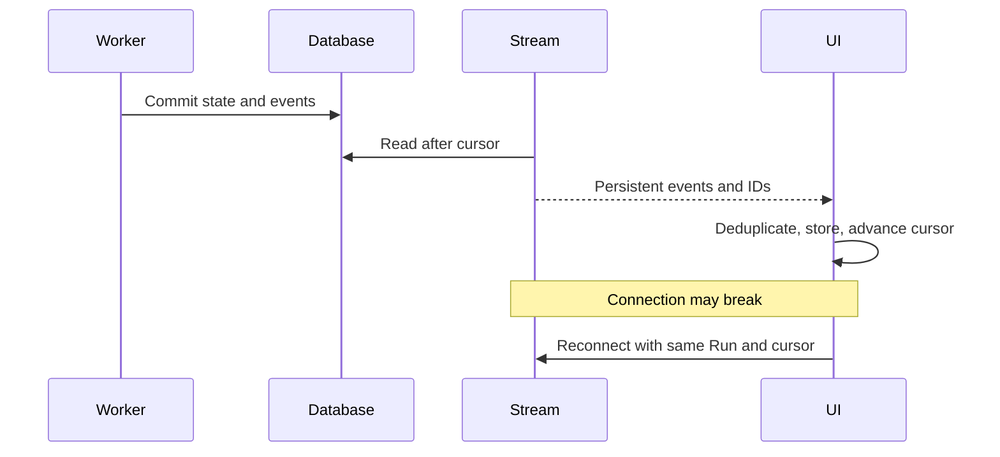

# Durable events and fault recovery

Execution state and events live in the control-plane database. A client observes persisted work; an uninterrupted connection is not required to keep the task alive.

## Persistence before observation

State changes and associated events are committed transactionally before streaming or paginated readers observe them. After seeing terminal state, the stream rechecks the final event page so a concurrent final commit cannot fall into an empty-page race.

Applications must coordinate their own event persistence and cursor. Memory-only cursors can replay after restart; saving a cursor before its event can lose UI history. Deduplication by Run/event ID is more dependable than assuming networks never deliver duplicates.

## Three different recovery cases

| Failure | What is known | Recovery |
| --- | --- | --- |
| Client disconnect | Observation stopped | Reconnect to the original Run, replay, query terminal state |
| Worker restart | A control-plane process stopped; durable records remain | A worker coordinates recovery using leases and persisted invocation identity |
| Runtime interruption | Sandbox supervision was interrupted; active invocations are not safely replayable by assumption | Quarantine old calls, record interruption/failure, investigate external effects |

Leases and generation fencing prevent stale workers from overwriting current ownership. They constrain control-plane writes; they do not put remote services inside the database transaction.

## Unreachable versus interrupted

Unreachable means the control plane cannot currently establish Runtime state. The process may still be running. Reinstalling the Harness or issuing a second side-effecting task is not a safe repair. Recovery contacts the existing binding and immutable invocation.

Interrupted reflects observed supervisor interruption behavior. Active invocations are quarantined rather than treated as normal idle wake. Previously dispatched Tool operations may still need reconciliation, and a known interrupted workspace is not automatically reused as healthy.

## Unknown does not prove failure

Cloud create/delete and Tool writes can take effect before their response is lost. Persisted operation journals retain intent and identifiers for reconciliation. A transport error cannot prove that no resource or write exists.

Run-submission idempotency applies to that request boundary, not global exactly-once behavior across third-party services. Approval records are not external-system transactions either. Inspect the dispatch policy and actual remote result.

Use these distinctions to show recoverable observation, uncertain execution, or required reconciliation instead of a universal “failed; retry” action. See [recovery actions](../build/recovery.md) and [event consumption](../build/stream-events.md). Sources: [architecture](../../../architecture.md), [state transactions](../../../../modules/execution/runs.ts), [stream route](../../../../apps/control-plane/server.ts).
