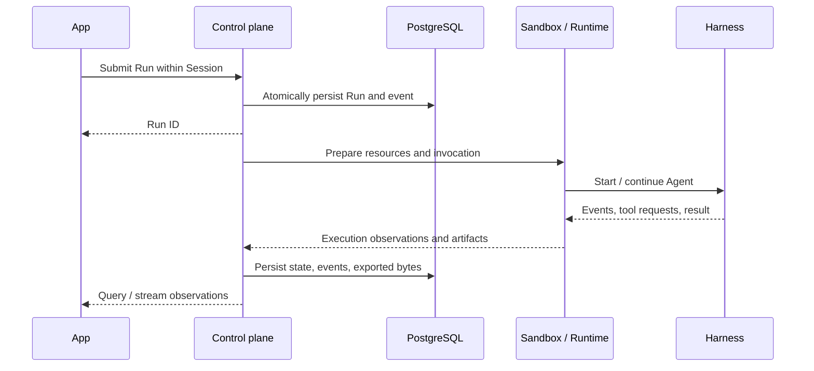

# Control plane, Runtime, Harness, and Sandbox

Hexagon separates durable task management from cloud process execution. This boundary helps locate failures and keeps Provider-specific operations out of application semantics.

| Layer | Owns | Does not own |
| --- | --- | --- |
| Application / SDK | Business authorization, submission intent, presentation | Proof that a cloud process terminated |
| Control plane | Sessions/Runs, scheduling, cloud operations, credentials, events, artifacts | Agent reasoning steps |
| Sandbox connector | Provider creation, inspection, files, execution, private access, cleanup | Business Session/Run semantics |
| Runtime | Sandbox process supervision, Harness invocation, Tool bridge | Provider account administration |
| Harness | Agent logic, model interaction, tool selection, conversation format | Tenant and approval enforcement |

Console consumes the same control-plane API; it is not an independent execution backend. Closing it does not stop tasks.

Authorization, approval, and unknown remote outcomes add waiting and reconciliation branches. This diagram does not assume every remote operation returns a response.

## Local and hosted

Local means an application/Console connects to a local control plane and PostgreSQL, which manage cloud Sandboxes. Hosted means an explicitly addressed and authenticated control plane manages those cloud Sandboxes. Deployment location changes; real execution is not replaced by local simulation.

Cloud execution needs access to protected model/HTTP credential ingress. Development ingress is separate from management; hosted deployments need stable ingress. Provider credentials remain in the control plane. The model proxy forwards allowed protocol traffic rather than automatically converting protocols.

## Diagnose by ownership

For disconnected clients, recover observation of the original Run. For worker restarts, inspect durable execution recovery. Unreachable Runtime does not prove stopped processes. A lost deletion response requires inspecting the original resource operation. Model protocol failures require checking Harness/endpoint compatibility, not replacing Session IDs to hide the issue.

Sources: [architecture](../../../architecture.md), [control-plane entry](../../../../apps/control-plane/main.ts). Next: [initialization](initialization.md), [events and recovery](events-and-recovery.md).
