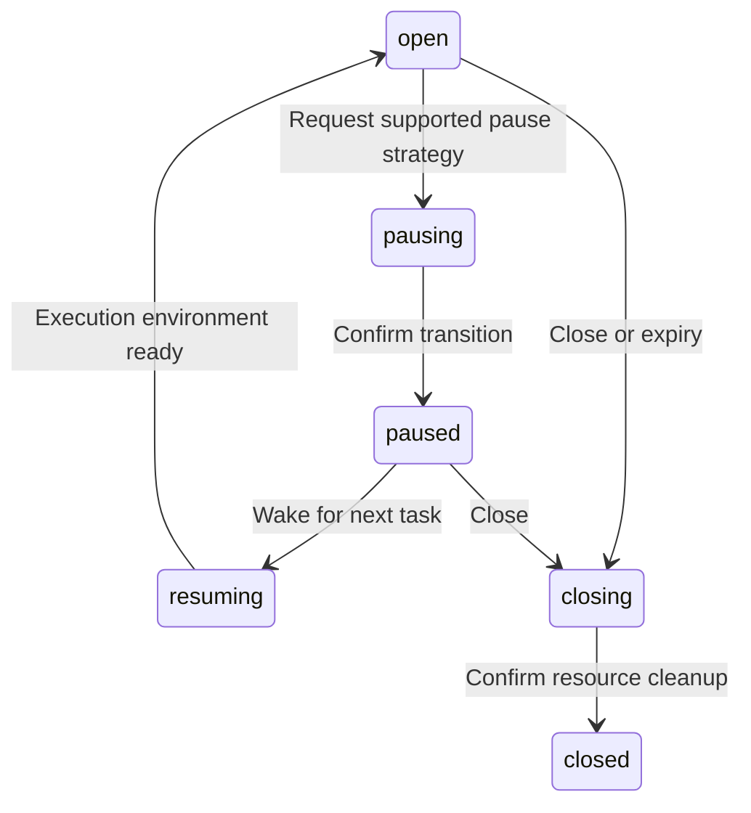

# Serverless Session lifecycle

Serverless describes idle compute management and preparation for the next submission. Durable Session identity and a Provider's current compute state are separate facts.

## Separate the state domains

Session states include open, pausing, paused, resuming, closing, and closed. Sandbox state and Runtime reachability are recorded separately. Provider-managed standby is not always observable, so an open Session does not establish continuously active compute; paused also needs its scope and Provider result interpreted.

This depicts principal managed transitions. Automatic Provider standby need not pass through every explicit platform pause state. Uncertain transitions remain investigable instead of being forced into their intended state.

## Four preservation strategies

Memory suspension preserves machine/process state. Filesystem recovery restarts Runtime with retained files. Snapshot recreation preserves Session identity while changing cloud resources. Provider-managed standby schedules compute upstream, with readiness recovered for the next task.

Depend on the managed workspace and verified Harness conversation recovery, not arbitrary processes, sockets, or temporary directories. Fly Machines can cold-boot; Modal can change resource IDs; Blaxel's actual standby cannot be conclusively observed through its API. See the [Provider strategy table](../../../serverless-sessions.md).

## Idle eligibility

Pause between Runs only. Authorization/approval waits remain active Runs. The next submit coordinates wake, Runtime recovery, and a new invocation without requiring a manual resume first.

Normal wake does not replay uncertain active invocations. Unknown snapshot/create/restore outcomes still need reconciliation. Automatic recovery is not permission for duplicate external writes.

## Closure, expiry, and cost

Close is terminal cleanup, not reversible suspension. Confirmed cleanup permits closed state; uncertain deletion retains closing and operation records. Sleeping is not absence and may still incur charges.

Control-plane-enforced deadlines require the service to be running; downtime prevents a guarantee of timely cloud deletion. Storage charges, account retention, and Provider limits remain independent of the idle timer.

Next: [configure and verify wake](../build/idle-and-wake.md), [persistence boundaries](persistence.md), [recovery](../build/recovery.md). Implementation: [lifecycle manager](../../../../modules/sandboxes/lifecycle.ts).
