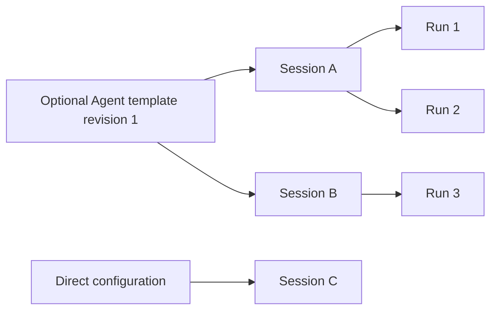

# Sessions, Runs, and Agent templates

A Session identifies a continuing work context. A Run identifies one submission. An Agent template identifies reusable execution configuration.

Sessions A and B can share a template while retaining independent workspaces and histories. C needs no template. Runs 1 and 2 execute sequentially in A; they cannot both be active.

## Durable Session identity

A Session pins its Harness, connection configuration, and optional template revision. It associates workspace, conversation, and cloud resources. Recreating an SDK client does not change its identity; an authorized client in another language can continue using the same ID.

A Session is not a cloud machine. Strategies such as Modal recreation can change the resource while preserving Session identity. Conversely, an existing Session record does not prove its original process or memory survives.

Closure is terminal and cleans up cloud resources. Suspension and Provider standby are continuation strategies. Historical Runs and exported artifacts can remain after closure without guaranteeing access to the former workspace.

## One traceable submission

A Run has input, idempotent request identity, state, durable events, and a result. A normal follow-up uses a new key and creates a new Run. Recovering a lost response reuses the original key to retrieve the original Run.

Authorization and approval waits remain active execution. Disconnecting a stream neither releases the one-active-Run constraint nor cancels work. A disconnected UI should resume observation instead of submitting duplicate work.

## Optional configuration reuse

Templates preserve immutable revisions. Revising does not overwrite existing Sessions; archiving does not close their resources. Create a new Session when a different pinned definition is needed, and explicitly transfer required inputs.

| Requirement | Choice |
| --- | --- |
| Continue editing a project | Same Session, new Run |
| Use the same setup for another project | Same template revision, new Session |
| Recover a lost submission response | Same Session, input, and key; original Run |

Sources: [Sessions](../../../../modules/execution/sessions.ts), [submission](../../../../modules/execution/runs.ts). Next: [multi-turn work](../build/multi-turn.md), [templates](../build/agent-templates.md), [recovery](../build/recovery.md).
