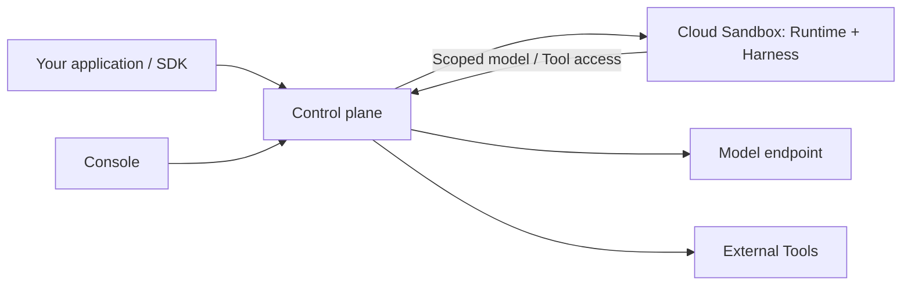

# Hexagon documentation

Hexagon is a self-hostable, open-source Agent control plane. Your application creates a continuing Session, runs tasks in cloud Sandboxes, observes durable events, and retrieves results and artifacts. For example, upload a Web project, ask an Agent to implement filtering, inspect its tests and preview, then continue in the same workspace.

**[Create your first Session](start/first-session.md)** · [Prepare a project task](build/project-context.md) · [中文](../zh-CN/index.md)

## See what completion looks like

After [installation](start/install.md) and connection setup, the first tutorial creates a direct Session; saving an Agent template is optional. This excerpt is taken from the [complete Python program](../../../examples/documentation/first-session.py):

```python
session = client.create_session(
    harness={'id': 'pi', 'version': '1.5.2'},
    sandbox_connection_id=sandbox, model_connection_id=model,
)
```

The complete program persists a submission key and Session/Run IDs, submits a task, polls its result, downloads artifacts, closes the Session and reads an artifact after closure. The excerpt alone does not include those steps. Use the [tutorial](start/first-session.md) for dependencies, Python/TypeScript execution and recovery instructions.

| Completion check | What you inspect |
| --- | --- |
| Identifiable work | Returned Session and Run IDs in a private journal |
| Finished task | Durable Run state is `completed`, with an actual assistant response |
| Useful artifact | Downloaded content matches `Hello from Hexagon` |
| Lifecycle completed | Session is `closed`; the exported artifact remains downloadable |

These are the tutorial's expected checks, not fabricated output or a claim of a fresh cloud run. A model saying “done” does not replace them. Cloud/model usage is billed through your configured accounts.

## Choose your next task

| Your goal | Primary guide |
| --- | --- |
| Add Agent execution to a product backend | [Backend integration](build/backend-integration.md) |
| Give an Agent project files and verify its work | [Project files and context](build/project-context.md) |
| Select and manage different execution combinations | [Choose integrations](integrations/choose.md) |

The [complete project tutorial](start/project-task.md) covers upload, fixed tests, private preview, a second modification and retained exports; its fresh dual-SDK cloud acceptance is pending. [Use cases](start/use-cases.md) explains product fit and boundaries.

## Understand where work runs



The control plane owns Session/Run state, durable events, credentials and cloud resources. Runtime supervises Harness processes inside the cloud Sandbox. Original provider/model/Tool credentials stay in the control plane; the guest receives scoped access. “Local” and “hosted” describe the control plane's location, not local versus cloud task execution. See [execution architecture](concepts/execution-architecture.md) and [security boundaries](concepts/security-boundaries.md).

## Enter by your responsibility

| You are… | Start here | Then continue |
| --- | --- | --- |
| Trying Hexagon | [Install](start/install.md) | [First Session](start/first-session.md) → [What happened](start/what-happened.md) |
| Building an application | [Backend integration](build/backend-integration.md) | [Events](build/stream-events.md), [approvals](build/approvals.md), [recovery](build/recovery.md) |
| Operating a deployment | [Self-hosting](operate/self-host.md) | [Networking](operate/networking.md), [diagnostics](operate/observability.md), [backup](operate/backup-restore.md) |
| Extending the project | [Development setup](contribute/development.md) | [Code map](contribute/codebase.md), [tests and evidence](contribute/testing.md) |

Coding Agents can use the [integration reading guide](agents.md). Browse the [complete documentation directory](directory.md) for all existing pages, including provider guides, concepts, extension guides and reference entries.

## Check capabilities and evidence

Start with [Sandbox capabilities](integrations/sandboxes.md), [Harness contracts](integrations/harnesses.md) and [model protocols](integrations/model-protocols.md), then inspect [dated verified combinations](integrations/verified-combinations.md). Registration, supported capability and real execution evidence are separate facts; there is no blanket guarantee for every cross-product.

A client disconnect does not cancel a Run. Explicitly close unused Sessions and reconcile unknown operations before claiming cleanup. Use [troubleshooting](operate/troubleshooting.md) or [resource reconciliation](operate/reconciliation.md) when progress or cleanup is uncertain.

Read [changes and upgrade notes](changelog.md) before changing versions. Product docs remain drafts under active completion; the [coverage ledger](../coverage.json) identifies unfinished assets. Exact API/SDK/configuration references are still being completed; current implementation-backed details remain in the [SDK guide](../../../sdk/README.md) and linked source. The repository's [release policy](../../../release-policy.json) does not yet approve publication. No public hosting or download channel is implied by these local pages.

[Repository README](../../../README.md)
