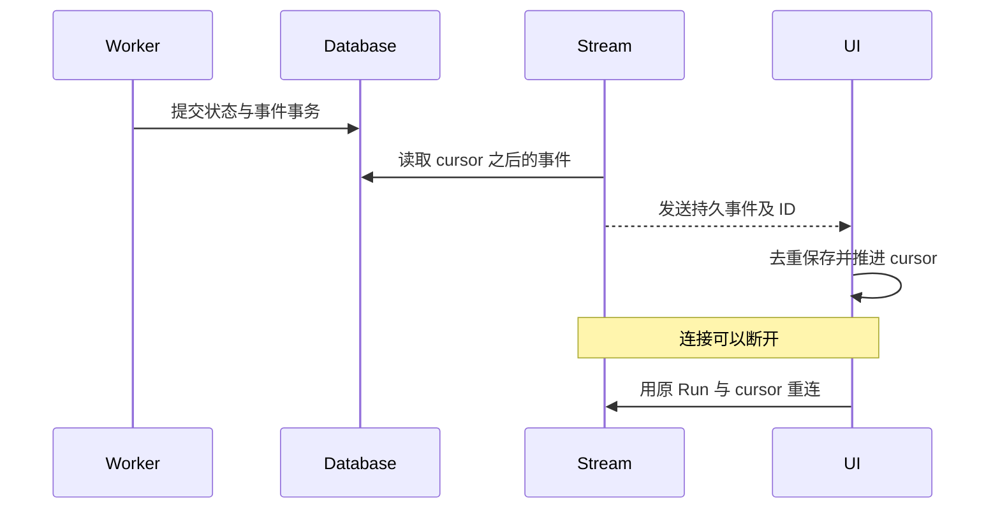

# 持久事件与故障恢复

Hexagon 的运行状态和事件保存在控制平面数据库中。客户端读取的是持久执行记录，而不是依赖一条永远在线的连接来维持任务。

## 写入顺序为什么重要

状态变更与相关事件在事务中保存，然后供流式或分页接口读取。这样客户端断线不会让已经提交的状态变化消失。服务端在观察到终态后再次补读事件，避免最后一个事件在空页与终态查询之间被遗漏。

应用保存事件和消费位置时同样需要协调。仅在内存中保存游标，重启后可能重放；先保存游标再丢失事件会漏掉界面记录。按 Run/event ID 去重通常比追求网络上绝不重复发送更可靠。

## 三类恢复不能混为一谈

| 故障 | 可以确定什么 | 恢复方式 |
| --- | --- | --- |
| 客户端断线 | 只知道观察中断 | 重连原 Run，补读事件，查询终态 |
| worker 重启 | 控制平面进程丢失，但数据库仍有执行记录 | 新 worker 根据 lease 和持久 invocation 协调恢复 |
| Runtime 中断 | Sandbox 侧执行监督进程丢失，先前活动 invocation 不能视为安全重放 | 隔离旧调用，记录失败 / interrupted，调查外部副作用 |

worker 使用 lease 和 generation fencing，过期 worker 不能任意覆盖新持有者的状态。这个机制约束控制平面写入，不意味着外部服务也参与同一数据库事务。

## unreachable 与 interrupted

Runtime unreachable 表示暂时无法确认远端状态。进程可能仍运行，因此不能重新安装 Harness 或再发送一份有副作用的任务来“修复”。恢复流程优先联系原绑定和不可变 invocation。

Runtime interrupted 表示观察到了监督进程中断相关状态。它与单纯网络不通不同，旧活动调用被隔离；已发出的工具操作仍可能需要对账。已知中断工作区不被当作普通空闲唤醒直接重用。

## unknown 不是失败证明

云创建、删除或 Tool 写入可能生效后丢失响应。此时持久操作日志保留意图和标识，供后续核对。网络层错误不能证明“没有创建资源”或“没有写入”。

Run 提交的幂等键只针对该请求边界，不能推出所有第三方写入具有全局 exactly-once 语义。审批记录也不是外部系统事务。必须检查实际调用策略与远端结果。

理解上述边界后，应用可以在中断时显示“正在恢复观察”“执行状态待确认”或“需要对账”，而不是一律显示“失败，请重试”。具体动作见[恢复指南](../build/recovery.md)，流消费见[事件指南](../build/stream-events.md)。实现依据：[架构](../../../architecture.md)、[执行状态事务](../../../../modules/execution/runs.ts)、[流路由](../../../../apps/control-plane/server.ts)。
