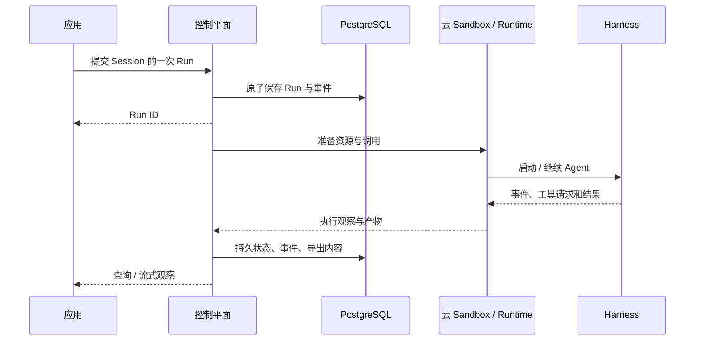

# 控制平面、Runtime、Harness 与 Sandbox

Hexagon 把持久任务管理和云端进程执行分开。理解这个边界，可以判断故障应该在哪一层调查，也能避免扩展时让不同 Provider 的逻辑侵入应用接口。

## 责任分工

| 层 | 拥有的责任 | 不由它决定的事 |
| --- | --- | --- |
| 应用 / SDK | 业务权限、提交意图、结果展示 | 云进程是否已经终止 |
| 控制平面 | Session / Run、调度、云资源操作、凭据、事件、产物 | Agent 的具体推理步骤 |
| Sandbox connector | 云创建、查询、文件、执行、私有访问、清理适配 | 业务 Session / Run 语义 |
| Runtime | Sandbox 内进程监督、Harness 调用与工具桥接 | Provider 账户管理 |
| Harness | Agent 逻辑、模型调用、工具选择、对话格式 | 控制平面的租户和审批规则 |

Console 消费同一控制平面 API。它配置、观察和管理工作，不是另一套独立执行后端。关闭 Console 不会关闭后台任务。

## 一次任务的顺序

工具可能进入授权或审批等待，云操作可能进入未知状态，因此实际流程包含暂停观察和对账分支。图示不是“每个远程请求一定收到响应”的承诺。

## local 与 hosted

local：应用 / Console → 本机控制平面和 PostgreSQL → 云 Sandbox。hosted：应用 / Console → 显式地址与 Token 的控制平面和数据库 → 云 Sandbox。改变的是控制平面位置，不是把真实执行替换成本机模拟。

云环境需要访问受保护模型或 HTTP 凭据通道。本地开发入口与管理 API 分离；hosted 使用稳定入口。Provider 管理凭据留在控制平面。模型代理按固定策略转发协议，不负责自动转换不同模型协议。

## 用边界定位故障

应用断流：先恢复原 Run 的观察。worker 重启：观察持久 lease 和执行恢复。Runtime 不可达：不能推断进程停止。Provider 删除响应丢失：查原操作和资源 ID。模型协议失败：查 Harness 与端点兼容性，而不是更换业务 Session ID 掩盖问题。

依据：[实现架构](../../../architecture.md)、[控制平面入口](../../../../apps/control-plane/main.ts)。下一步：[初始化](initialization.md)、[事件与恢复](events-and-recovery.md)。
