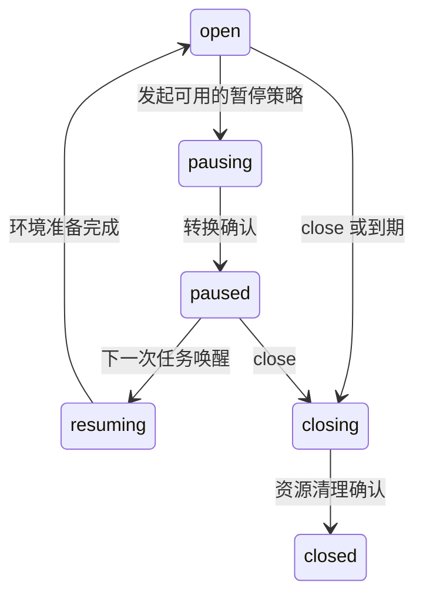

# Serverless Session 的生命周期

Serverless 在这里描述空闲时如何管理计算资源，以及下一次提交如何恢复工作上下文。Session 的持久身份与某个 Provider 当前的计算状态是两件事。

## Session 与资源状态分开看

Session 有 open、pausing、paused、resuming、closing、closed 等状态。Sandbox 的运行 / 暂停状态和 Runtime 可达性另行记录。Provider managed standby 未必能从 API 精确观测，所以 open Session 不证明计算一直活跃，paused 也需要结合暂停 scope 和 Provider 返回判断。

图示为主要受管理路径；Provider 自动 standby 不必经过平台的每个显式暂停状态。过渡结果不明时状态可能保留待调查，不能为了图表完整而强行推到目标态。

## 四种保留机制

内存暂停保留虚拟机或进程状态；磁盘恢复保留文件并重启 Runtime；快照重建保持 Session 身份但更换云资源；Provider managed standby 由供应商调度，平台在下一次任务时恢复可用执行。

应用应依赖受管理工作区和已验证的 Harness 对话恢复，避免依赖任意进程、socket 和临时目录。Fly Machines 有冷启动回退；Modal 可以更换资源 ID；Blaxel 的实际 standby 不可由其 API 明确确认。具体策略见[当前 Provider 表](../../../serverless-sessions.md)。

## 谁能进入空闲

只在 Runs 之间暂停。等待授权或审批仍是活动 Run，不能当作空闲回收。下一次 submit 由 worker 协调唤醒、Runtime 恢复与新 invocation，不要求应用先手工 resume。

正常唤醒不重放不确定的活动 invocation。快照、创建或恢复操作结果未知时仍需要对账；“自动恢复”不能掩盖重复外部写入风险。

## 关闭、到期与费用

close 是终态清理，不是可逆暂停。控制平面确认资源清理后才记录 closed；不确定删除保留 closing 和操作记录。供应商睡眠不是资源不存在，也不一定停止所有费用。

由控制平面执行的期限需要服务在线。控制平面停机不能保证按时完成云删除。存储费、账户保留期限和各 Provider 限制独立存在，不能根据 idle_timeout 直接推导账单。

下一步：[配置并验证自动唤醒](../build/idle-and-wake.md)、[持久化边界](persistence.md)、[未知结果恢复](../build/recovery.md)。实现依据：[生命周期管理](../../../../modules/sandboxes/lifecycle.ts)。
