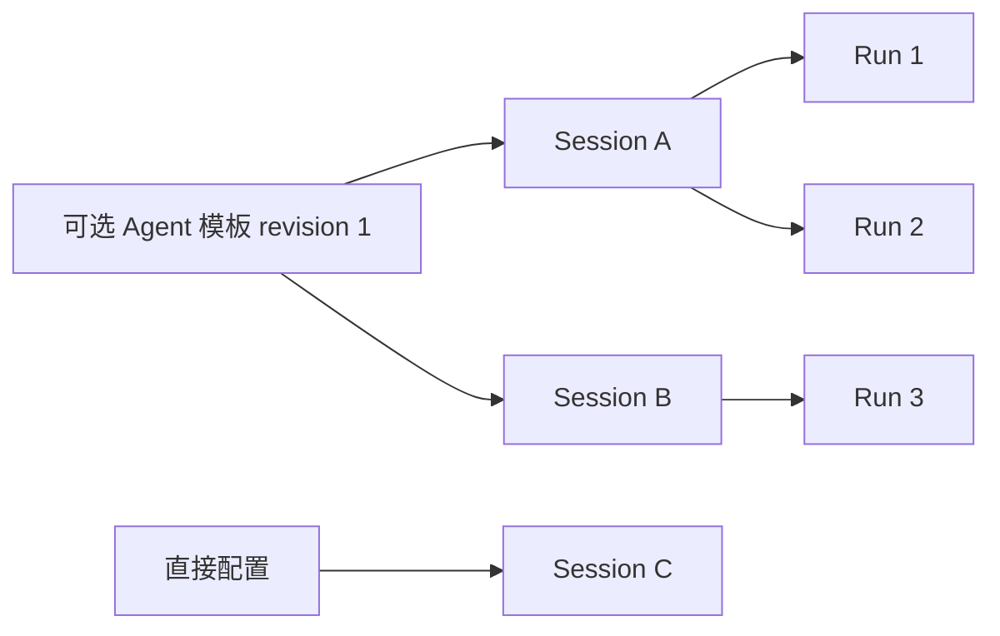

# Session、Run 与 Agent 模板

这三个对象回答不同的问题：Session 表示在哪个持续工作上下文中执行，Run 表示哪一次提交，Agent 模板表示复用哪份执行配置。

## 对象关系

Session A 与 B 可以使用同一模板，却具有不同工作区和运行历史。Session C 完全不需要模板。Run 1 和 Run 2 在 A 中先后执行，不能同时成为活动 Run。

## Session 是持久身份

Session 固定 Harness、连接配置和可选模板 revision，关联工作区、对话状态和云资源。SDK 客户端重建不会改变其身份；只要权限允许，另一语言的 SDK 也能通过相同 ID 继续操作。

Session 不等同云机器。Modal 等策略可以重建底层资源并保留 Session ID。反过来，Session 记录仍存在也不能证明原进程或内存仍在。

关闭是终态操作，回收云资源；暂停和 Provider standby 是可继续的生命周期策略。历史 Run 与导出 Artifact 可以在关闭后保留，而原工作区不能据此视为永久可访问。

## Run 是一次可追踪提交

每个 Run 有输入、幂等请求身份、执行状态、持久事件和最终结果。正常第二轮使用新 key 创建新 Run；同一请求响应丢失则复用原 key 找回原 Run。

等待授权或审批仍属于活动执行。断开事件流不释放活动 Run 限制，也不取消任务。如果界面显示“连接中断”，应用应恢复观察原 Run，而不是自动提交第二份任务。

## 模板是可选复用

Agent 模板用不可变修订记录配置演进。修改模板不会覆盖既有 Session，归档模板也不会关闭其创建的云资源。需要更换已固定的执行定义时，创建新 Session 并明确迁移需要的输入。

## 三个判断例子

| 需求 | 对象选择 |
| --- | --- |
| 在同一项目继续改代码 | 原 Session，新 Run |
| 用相同配置处理另一个项目 | 相同模板 revision，新 Session |
| 提交响应丢失 | 原 Session、原输入与 key，恢复原 Run |

依据：[Session 实现](../../../../modules/execution/sessions.ts)、[Run 提交](../../../../modules/execution/runs.ts)。下一步：[多轮工作](../build/multi-turn.md)、[模板操作](../build/agent-templates.md)、[恢复](../build/recovery.md)。
